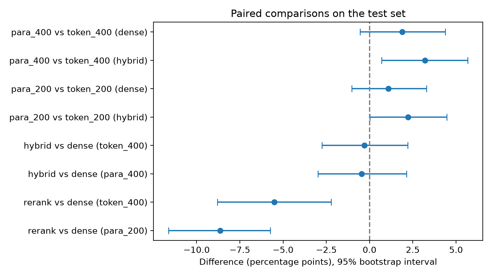
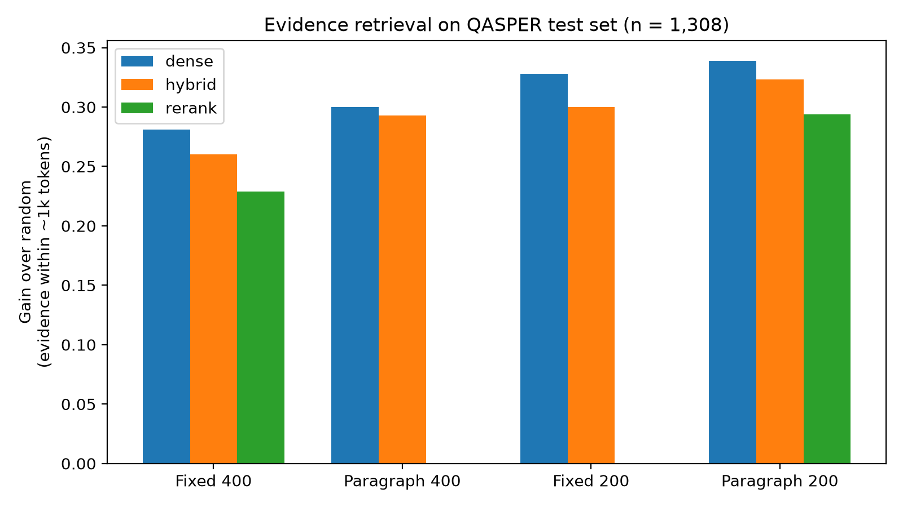

# Does Chunking Matter? Evaluating Retrieval for RAG on Scientific Papers

A retrieval-augmented generation (RAG) system over NLP research papers, built from scratch, plus a controlled evaluation of how **chunking strategy** and **retrieval method** affect whether the system finds the evidence needed to answer a question.

The system answers questions about papers in the [QASPER](https://allenai.org/data/qasper) dataset. The evaluation measures, across 16 configurations and 2,196 questions, how often each configuration retrieves the passage that human annotators marked as the evidence.

---

## Key findings

All numbers are from QASPER's held-out **test split** (416 papers, 1,308 questions), run once on configurations chosen in advance on the development split.

1. **A cross-encoder reranker made retrieval significantly worse.** `bge-reranker-base` ranked the evidence first 5.5 and 8.6 percentage points less often than plain dense retrieval (p ≤ 0.002), at about 18× the runtime.
2. **Hybrid search (BM25 + dense) did not beat dense retrieval.** A gain seen on the development set did not replicate on test; the differences were −0.3 and −0.5 points, with 95% intervals spanning zero.
3. **Paragraph-aware chunking helped in every comparison.** It beat fixed-size token chunking in all 4 test comparisons and all 6 development comparisons. The effect was statistically significant with hybrid retrieval (+3.2 and +2.2 points) and positive but not individually significant with dense retrieval alone (+1.9 and +1.1 points).
4. **Choices matter most when context is scarce.** Configurations differ clearly when the system can pass ~1,000 tokens of text to the language model; at ~2,000 tokens they converge.

The best configuration was **paragraph-aware chunking (≤200 tokens) with dense retrieval**.



*Each dot is the mean per-question difference between two configurations; bars are 95% paired-bootstrap intervals. Intervals that cross the dashed line are not statistically significant.*

---

## The question

A RAG system splits documents into **chunks**, finds the chunks most relevant to a question, and hands them to a language model to write an answer. If the right chunk isn't retrieved, the language model can't answer correctly, however capable it is.

Two design choices control retrieval:

- **How documents are chunked:** fixed-size windows, or boundaries that follow the document's structure?
- **How chunks are ranked:** dense embeddings, keyword search (BM25), a combination, or a cross-encoder reranker?

Common advice says hybrid search and reranking improve retrieval. This project tests that advice on long scientific papers, where every chunk in a document is on the same topic and the hard part is finding the *specific* passage that answers a question.

---

## Dataset

**QASPER** contains questions written by NLP researchers about NLP papers, with answers and **evidence**: the paragraphs annotators marked as supporting each answer.

| | Development (validation split) | Test (held out) |
|---|---|---|
| Papers | 281 | 416 |
| Questions evaluated | 888 | 1,308 |

Filtering applied before evaluation:

- Evidence that points at tables or figures (marked `FLOAT SELECTED`) is removed; only text evidence is used.
- Evidence shorter than 5 words is removed (this drops section headings that annotators sometimes selected).
- Evidence from all annotators is combined and de-duplicated: a paragraph is relevant if *any* annotator cited it.
- Questions with no remaining evidence are excluded (113 on the development split had none).

Papers average 48 paragraphs (up to 292), long enough that chunking choices matter.

---

## Method

### Pipeline

```
INDEXING (once per chunker)                  QUERY TIME (per question)

QASPER papers                                question + paper ID
     │                                            │
loader.py   → clean paragraphs              embed the question
     │                                            │
chunking.py → chunks + character spans      rank that paper's chunks
     │                                            │
index.py    → embed, store in Postgres      top chunks → LLM → cited answer
              (pgvector)                          (ask.py)
```

Retrieval is always scoped to the question's own paper. QASPER questions refer to "they" and "this paper", so searching across papers would mix chunking quality with identifying the right paper.

### Chunkers

| Name | How it splits | Size |
|---|---|---|
| `token_400_80` | Fixed window over model tokens, 80-token overlap | 400 tokens |
| `token_200_40` | Fixed window over model tokens, 40-token overlap | 200 tokens |
| `para_400` | Merges consecutive paragraphs up to the limit; splits oversized paragraphs | ≤400 tokens |
| `para_200` | Same, smaller limit | ≤200 tokens |

Chunk sizes are measured with the embedding model's own tokenizer. An early version chunked by words and produced chunks up to 655 tokens, past the model's 512-token limit, so their endings were silently ignored. Chunks are cut by slicing the original text at token boundaries, which keeps casing and spacing intact.

### Retrievers

| Name | How it ranks chunks |
|---|---|
| `dense` | Cosine similarity between `BAAI/bge-small-en-v1.5` embeddings (384 dimensions) |
| `bm25` | BM25 keyword scoring (`rank_bm25`), with the index built over the paper's chunks |
| `hybrid` | Reciprocal rank fusion of dense and BM25: each chunk scores Σ 1/(60 + rank) |
| `rerank` | Cross-encoder `BAAI/bge-reranker-base` scores every (question, chunk) pair |

Papers have 16–37 chunks on average, so the reranker scores *every* chunk rather than a shortlist.

### Labelling relevant chunks

Every chunk stores its start and end character positions in the paper's text. Each evidence paragraph is located in the same text, giving it a span too. Relevance is then arithmetic on spans:

> A chunk is **relevant** if it covers at least 50% of an evidence paragraph, **or** if at least 50% of the chunk is evidence.

The second condition matters for small chunks: a 200-token chunk cannot cover half of a 600-token evidence paragraph even when it consists entirely of evidence. The rule was validated against a failure diagnosed by hand (an evidence paragraph split across two fixed-size chunks), where it labelled exactly the chunk identified manually.

### Metrics

- **Hit@k:** the evidence is among the top *k* chunks.
- **MRR:** mean of 1/(rank of the first relevant chunk).
- **Hit within a budget:** walking down the ranked list and adding up chunk lengths, does a relevant chunk start before ~1,000 tokens (4,750 characters) or ~2,000 tokens (9,500 characters) of text?

Hit@k and MRR are unfair across chunkers: with smaller chunks, the top 5 covers less of the paper. The budget metric compares chunkers at an **equal amount of retrieved text**, which is what a language model's context window actually limits.

- **Random baseline:** every metric is also computed for 200 random orderings of the paper's chunks (seeded). Papers have few chunks, so random retrieval scores surprisingly well (Hit@5 ≈ 0.53 on the development set). Results are reported as **gain over random**.

### Experimental protocol

1. All comparisons and design decisions were made on the development split.
2. Before touching the test split, the configurations to run and the expected outcomes were written down and committed to Git.
3. Each pre-registered configuration was run once on test. Results are reported as they came out, including an expectation that failed.
4. Differences were tested with a **paired bootstrap** (10,000 resamples): both configurations answer the same questions, so per-question differences cancel out question difficulty.

---

## Results

### Test split (1,308 questions)

| Chunker | Retriever | Hit@1 | MRR | Hit ~1k | Gain ~1k | Hit ~2k | Gain ~2k |
|---|---|---|---|---|---|---|---|
| token_400_80 | dense | 0.365 | 0.554 | 0.690 | 0.281 | 0.845 | 0.208 |
| token_400_80 | hybrid | 0.362 | 0.551 | 0.669 | 0.260 | 0.845 | 0.208 |
| token_400_80 | rerank | 0.310 | 0.509 | 0.638 | 0.229 | 0.822 | 0.185 |
| token_200_40 | dense | 0.317 | 0.492 | 0.751 | 0.328 | 0.888 | 0.239 |
| token_200_40 | hybrid | 0.292 | 0.471 | 0.723 | 0.300 | 0.887 | 0.238 |
| para_400 | dense | 0.357 | 0.542 | 0.720 | 0.300 | 0.881 | 0.218 |
| para_400 | hybrid | 0.352 | 0.538 | 0.713 | 0.293 | 0.880 | 0.217 |
| **para_200** | **dense** | 0.330 | 0.498 | **0.793** | **0.339** | **0.923** | 0.228 |
| para_200 | hybrid | 0.300 | 0.476 | 0.777 | 0.323 | 0.914 | 0.219 |
| para_200 | rerank | 0.244 | 0.425 | 0.748 | 0.294 | 0.898 | 0.203 |

*Gain = hit rate minus the random baseline at the same budget. Compare chunkers by gain; compare retrievers on the same chunker by any metric.*



*Rerank was evaluated on two chunkers only.*

### Pre-registered expectations vs. test

| Expectation (from development split) | Test result |
|---|---|
| Paragraph chunking beats fixed-token chunking at equal size | Confirmed in direction, 4/4 |
| Hybrid beats dense with ~400-token chunks | **Not replicated** |
| Reranker underperforms dense | Confirmed, 2/2 |
| `para_200` + dense has the highest gain at ~1k tokens | Confirmed |

### Significance (paired bootstrap, test split)

| Comparison | Metric | Difference | 95% CI | p |
|---|---|---|---|---|
| para_400 vs token_400 (dense) | gain ~1k | +1.9 | [−0.5, +4.4] | 0.128 |
| para_400 vs token_400 (hybrid) | gain ~1k | +3.2 | [+0.7, +5.7] | 0.009 |
| para_200 vs token_200 (dense) | gain ~1k | +1.1 | [−1.0, +3.3] | 0.321 |
| para_200 vs token_200 (hybrid) | gain ~1k | +2.2 | [+0.0, +4.5] | 0.048 |
| hybrid vs dense (token_400) | Hit@1 | −0.3 | [−2.8, +2.2] | 0.843 |
| hybrid vs dense (para_400) | Hit@1 | −0.5 | [−3.0, +2.1] | 0.742 |
| rerank vs dense (token_400) | Hit@1 | −5.5 | [−8.8, −2.2] | 0.002 |
| rerank vs dense (para_200) | Hit@1 | −8.6 | [−11.6, −5.7] | <0.001 |

*Differences in percentage points. With eight tests, a Bonferroni-corrected threshold (p < 0.006) leaves only the two reranker results significant. The paragraph-chunking claim rests on its consistency across all comparisons rather than on any single test.*

---

## Failure analysis

Only 39 of 1,308 test questions (3.0%) were missed by **all ten** configurations, so most failures are specific to a configuration. A seeded sample of 20 of these was read and categorized by hand:

| Category | Count | What happens |
|---|---|---|
| Questionable label | 6 | A retrieved chunk does answer the question, but annotators marked a different passage. |
| Wording mismatch | 6 | The evidence uses different terms from the question (e.g. "ground truth" for "gold standard", "dropout" for "regularisation"), while wrong chunks share the question's words. |
| Summary-section pull | 3 | The abstract or conclusion restates the question's vocabulary and outranks the specific evidence. |
| Implicit answer | 3 | The answer must be inferred (often yes/no questions); the key terms never appear. |
| Answer in a table | 1 | The evidence text only points to a table holding the answer. |
| Boilerplate pull | 1 | The acknowledgments section outranked the evidence. |

About 30% of the sampled hard failures are labelling artifacts: papers often state a fact in more than one place, and annotators mark one. The evaluation therefore **underestimates** retrieval quality somewhat.

---

## Limitations

- **Incomplete evidence labels.** See the failure analysis; some "misses" are correct retrievals.
- **One embedding model and one reranker.** The reranker result may not hold for rerankers trained on scientific text or for larger models.
- **Within-paper retrieval only.** Searching across many papers is a different and harder problem.
- **Multiple comparisons.** Only the reranker result survives a Bonferroni correction.
- **Text extraction noise.** QASPER's text contains garbled LaTeX and numbers, which can affect both embedding and keyword matching.
- **Generation is not evaluated.** The evaluation measures retrieval only, so chunker and retriever quality are not mixed with language model behaviour. Spot checks showed the language model sometimes refuses even when the evidence is retrieved.

## Future work

- Down-weight abstract and conclusion chunks for detail questions (addresses summary-section pull).
- Test rerankers fine-tuned on scientific text, and larger embedding models.
- Evaluate end-to-end answer quality, including the refusal behaviour of the generation prompt.
- Extend the pipeline into an agent that can search, read and follow references across papers.

---

## How the code works

### File structure

```
rag-project/
├── loader.py            Load and clean QASPER papers and questions
├── chunking.py          The chunkers
├── index.py             Chunk, embed and store papers in Postgres
├── retrievers.py        The four ranking methods
├── labels.py            Locate evidence and label relevant chunks
├── eval.py              Score one chunker + retriever on a split
├── ask.py               Ask a question, get a cited answer from an LLM
├── significance.py      Paired bootstrap tests
├── make_table.py        Results table from a split's summary.csv
├── make_figures.py      The two figures
├── failures.py          Find questions every configuration misses
├── docker-compose.yml   Postgres + pgvector
├── requirements.txt
├── .env.example         Copy to .env and set the database password
├── NOTES.md             Lab notebook: every decision and result, in order
├── results/
│   ├── validation/      summary.csv + one per-question CSV per configuration
│   └── test/            same, plus significance.csv and failures.md
├── figures/
└── scratch/             Learning and one-off exploration scripts
```

### The life of an evaluation, file by file

**`loader.py`: from raw dataset to clean text**

- `load_papers(split, limit)` returns one dict per paper: `id`, `title`, `paragraphs` (abstract first, then every body paragraph, empty ones removed, whitespace normalized), and `text`, the paragraphs joined with single spaces. Chunk positions and evidence positions both refer to this `text` string, so it must be built identically everywhere.
- `load_questions(split, limit, min_words)` returns one dict per usable question: `paper_id`, `question_id`, `question`, and `evidence`, a de-duplicated list of normalized evidence paragraphs. It applies the dataset filters described above.

**`chunking.py`: cutting papers into pieces**

Every chunker returns a list of `(text, char_start, char_end)` tuples, so the rest of the code doesn't care which chunker produced them.

- `token_chunks(paragraphs, tokenizer, size, overlap)` tokenizes the whole paper once, with the tokenizer reporting each token's character positions. A window of `size` tokens slides forward by `size − overlap` tokens, and each window becomes the slice of original text between its first token's start and its last token's end.
- `para_chunks(paragraphs, tokenizer, max_tokens)` walks through the paragraphs, tracking each one's position in the joined text. Paragraphs are added to the current chunk while they fit under `max_tokens`; when the next one doesn't fit, the chunk is emitted and a new one starts. A single paragraph larger than the limit is split with `token_chunks`, with its positions shifted to the paper's coordinates.
- `fixed_chunks` is the original word-based chunker, kept for reference; it was replaced because it exceeded the token limit.

**`index.py`: storing chunks (indexing time)**

Run as `python index.py token 400 80` or `python index.py para 200`. For every paper in the split it chunks the paper, embeds all its chunks in one call, and inserts rows into the `chunks` table: `paper_id`, `chunker`, `chunk_index`, `char_start`, `char_end`, `content`, `embedding`. Before inserting, it deletes only *this chunker's rows for this split's papers*, so re-running one configuration never touches another. It also checks every chunk's token count against the model's 512-token limit.

**`retrievers.py`: ranking a paper's chunks (query time)**

- `fetch_paper_chunks(conn, paper_id, chunker)` loads one paper's chunks, with spans, text and embeddings, in a single query. Every ranker works on this list.
- `dense_rank` embeds the question, takes the dot product with every chunk embedding (cosine similarity, because all vectors are normalized), and sorts.
- `tokenize` lowercases text and extracts words with the regex `\w+`.
- `bm25_rank` builds a BM25 index over the paper's chunks and scores the question's words.
- `rrf_fuse(rankings, k=60)` combines several rankings by adding 1/(k + rank) for each chunk. It uses ranks, not scores, because dense and BM25 scores are on different scales.
- `hybrid_rank` fuses the dense and BM25 rankings.
- `rerank_rank` scores each (question, chunk) pair with the cross-encoder.

Each ranker returns chunk indices, best first.

**`labels.py`: the answer key**

- `evidence_spans(paper_text, evidence)` finds each evidence paragraph in the paper's text and returns its `(start, end)` positions. Evidence that can't be found verbatim is skipped.
- `coverage(...)` is the fraction of an evidence span that a chunk covers.
- `chunk_purity(...)` is the fraction of a chunk that is evidence.
- `relevant_chunks(chunks, spans, threshold=0.5)` returns the set of chunk indices that pass either test.

**`eval.py`: the grader**

Run as `python eval.py para_200 dense`, with `SPLIT=test` in front for the test split. For each question it finds the evidence spans, fetches the paper's chunks, labels the relevant ones, ranks *all* chunks with the chosen retriever, and records:

- `first_relevant_rank`: the position of the first relevant chunk,
- `hit_within_budget`: whether a relevant chunk starts within the text budget,
- `random_baseline`: the same metrics averaged over 200 seeded random orderings.

It writes one row per question to `results/<split>/per_question_<chunker>_<retriever>.csv` and appends one summary row to `results/<split>/summary.csv`.

**`ask.py`: the RAG system itself**

`retrieve` fetches the top 5 chunks with a pgvector SQL query, `build_prompt` numbers them and adds instructions to cite passages and to refuse when the context lacks the answer, and `generate` sends the prompt to `llama3.1:8b` through Ollama at temperature 0.

**Analysis scripts**

- `significance.py`: `paired_diffs` lines up two configurations' per-question scores, and `bootstrap` resamples questions 10,000 times to get a 95% interval and p-value for the difference.
- `make_table.py <split>`: prints the latest summary row for every configuration as a Markdown table.
- `make_figures.py`: draws the two figures from the test results.
- `failures.py`: intersects every configuration's misses and writes a sample of hard questions, with their evidence and what was retrieved instead, to `results/test/failures.md`.

---

## Reproducing the results

Requirements: Python 3.12, Docker, and (for `ask.py` only) [Ollama](https://ollama.com).

```bash
# 1. Setup
python3.12 -m venv .venv
source .venv/bin/activate
pip install -r requirements.txt
cp .env.example .env              # then set POSTGRES_PASSWORD and DATABASE_URL
docker compose up -d              # Postgres + pgvector on port 5433

# 2. Index both splits with all four chunkers
for split in validation test; do
  SPLIT=$split python index.py token 400 80
  SPLIT=$split python index.py token 200 40
  SPLIT=$split python index.py para 400
  SPLIT=$split python index.py para 200
done

# 3. Development grid (all 16 configurations)
for c in token_400_80 token_200_40 para_400 para_200; do
  for r in dense bm25 hybrid rerank; do
    python eval.py $c $r
  done
done
python make_table.py validation

# 4. Test split (pre-registered configurations)
for c in token_400_80 token_200_40 para_400 para_200; do
  for r in dense hybrid; do
    SPLIT=test python eval.py $c $r
  done
done
SPLIT=test python eval.py token_400_80 rerank
SPLIT=test python eval.py para_200 rerank
python make_table.py test

# 5. Analysis
python significance.py
python make_figures.py
python failures.py

# 6. Ask a question (requires: ollama pull llama3.1:8b)
python ask.py
```

Indexing takes under a minute per chunker. Dense, BM25 and hybrid evaluations take seconds; each reranker run takes roughly 5–7 minutes on an Apple M4 Pro.

---

## Stack

Python, PostgreSQL with pgvector (Docker), sentence-transformers, rank-bm25, numpy, matplotlib, Ollama. No RAG framework: chunking, retrieval, labelling and evaluation are implemented directly, so every component can be inspected and changed.

## Author

Shivam Wadhwa